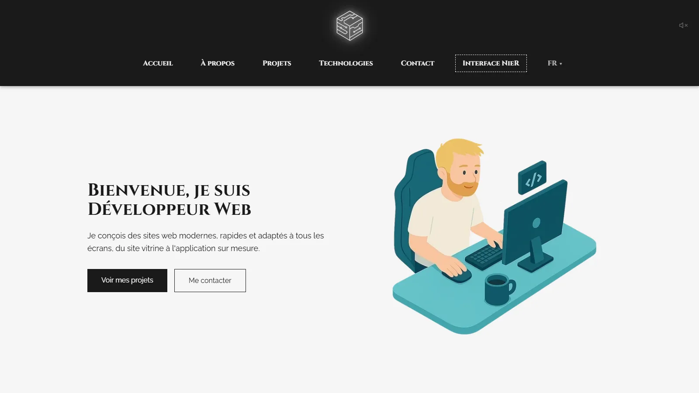
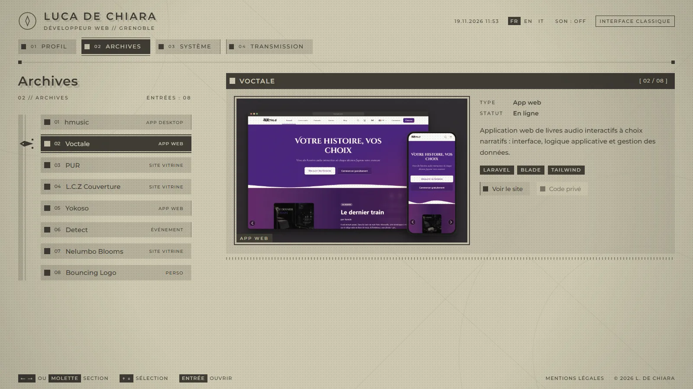
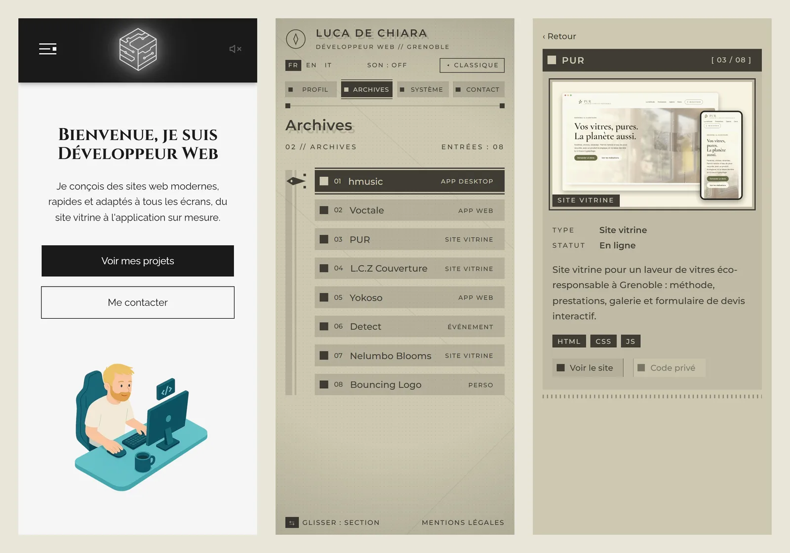

# Portfolio - Style *NieR:Automata*

Site portfolio personnel inspiré par l'univers de *NieR:Automata*.
Design épuré, mode sombre/clair, responsive et optimisé en performance.

---

## Aperçu

Le site existe en deux versions, entre lesquelles on peut basculer à tout moment.

**Interface classique** — [lucadechiara.fr](https://lucadechiara.fr/)



**Interface NieR** — [lucadechiara.fr/nier/](https://lucadechiara.fr/nier/)



**Sur mobile** — classique, puis NieR (liste et panneau de détail)



---

## Structure du projet

```
nier_portfolio_v2/
├── index.html
├── 404.html
├── style.css
├── script.js
├── projects.js
├── i18n.js
├── package.json
├── nier/                  # Interface NieR (menu de jeu plein écran)
│   ├── index.html
│   ├── nier.css
│   └── nier.js            # contenu FR / EN / IT + navigation
├── documents/
│   └── CV Luca De Chiara.pdf
└── assets/
    └── images/
```

---

## Fonctionnalités

**Deux interfaces au choix**
→ Le site classique (`/`) et une interface NieR façon menu de jeu (`/nier/`) : une seule page sans défilement, onglets de sections, liste + panneau de détail.
→ Navigation au clavier (← → sections, ↑ ↓ sélection), à la molette ou en glissant sur mobile.
→ Bascule dans les deux sens (lien « Interface NieR » / « Interface classique »), choix mémorisé via `localStorage`.
→ `/nier/` est en `noindex` : seule la page classique est référencée.
→ Même formulaire Netlify `contact` et même langue enregistrée sur les deux versions.

**Dark / Light mode**
→ Basculement entre les deux thèmes avec persistance via `localStorage`.

**Effets NieR (dark mode)**
→ Animation glitch, flash de corruption, son d'ambiance et effet scramble sur le logo NieR.
→ Bouton mute pour couper/rétablir le son, avec persistance via `localStorage`.
→ Effets désactivés automatiquement si `prefers-reduced-motion` est activé (accessibilité).

**Internationalisation (i18n)**
→ Support FR / EN / IT avec détection automatique de la langue du navigateur.

**Archive de projets (style NieR)**
→ Liste des projets avec panneau de détail sur desktop, accordéon sur mobile (aperçu, description, technos, liens).

**Responsive design**
→ Adapté aux mobiles, tablettes et écrans larges.
→ Détection tactile pour désactiver les effets lourds sur mobile.

**Formulaire de contact**
→ Envoi de message intégré directement depuis le site.

**Page 404 personnalisée**
→ Page d'erreur dans le style NieR.

**Performances optimisées**
→ Images en `.webp`, chargement rapide, score Lighthouse élevé.

---

## Déploiement Netlify

[](https://app.netlify.com/sites/ldcportfolio/deploys)

---

## Licence

© 2025 - De Chiara Luca

Projet open-source, utilisation libre à des fins personnelles ou d'inspiration.
